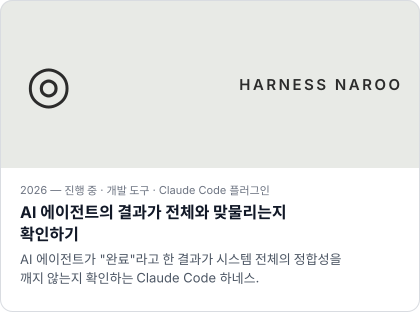
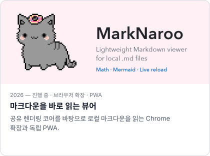

# Baek Ga-hui (백가희)
goraeng(고랭) · @neisii 
백엔드 엔지니어 9년 · AI-DLC

> 인프라를 늘리기보다 정해진 한계 안에서 병목을 찾습니다. 
> 같은 방식으로 AI 세션이 함께 일하는 체계를 세웠습니다.

[블로그](https://neisii.github.io/) · [AI-DLC 실무 사례](https://neisii.github.io/ai-dlc-si-portfolio/) · [이메일](mailto:neisii@outlook.com)

---

## 🧭 핵심 역량

- **제약 안 성능 최적화** — 오토 스케일링 없는 베어메탈 환경에서 서킷 브레이커·헬스체크 자동화·포트 그룹 무중단 배포로 트래픽 피크에 대응
- **레거시 현대화** — 행정안전부 하모니 시스템 No-ActiveX 대응, Pure JS·HTML5 File API로 웹 표준 전환
- **AI-DLC** — 규칙·스킬·도구로 여러 AI 세션을 운영하고, 결과가 시스템 전체와 맞는지 확인
- **서버리스 멀티 소스 집계** — Cloudflare Workers에서 세 provider를 병렬 호출해 가중 평균으로 집계, 장애·이상값이면 가중치를 다시 나눔

---

## 📝 블로그

[neisii.github.io](https://neisii.github.io/) — 글과 프로젝트 기록

<!-- BLOG-CARDS:START -->

최근 글

- [나라는 사람에 대하여](https://neisii.github.io/posts/about-me/) 2026-11-08
- [실무에서 바로 쓰는 Git: 네 가지 작업 흐름 가이드](https://neisii.github.io/posts/git-practical-guide/) 2026-11-05
<!-- BLOG-CARDS:END -->

---

## 🚀 대표 작업

### AI-DLC

- [AI-DLC 실무 사례](https://neisii.github.io/ai-dlc-si-portfolio/) — 준공공 커머스 차세대 SI(2026.07–10). 역할 세션 7개와 규칙·스킬·도구 체계로 담당 34화면을 일정보다 한 달 앞서 구현
- [git-deploy-extractor](https://github.com/neisii/git-deploy-extractor) — 커밋 이력에서 배포 대상 파일을 뽑아 망 분리 환경용 배포 묶음을 만드는 데스크톱 도구. 철수 뒤에도 프로젝트 팀이 사용 중(v0.9.1)
- [ai-development-orchestrator](https://github.com/neisii/ai-development-orchestrator) — 여러 AI 에이전트의 대화를 사람이 승인·기록하는 오케스트레이터. Claude Code 기본 기능이 나오자 멈추고 차이를 비교했고, 그 통제 방식이 하네스 규칙이 됨
- [gate3-trial](https://github.com/neisii/gate3-trial) — 공개판 하네스 출시 전 시험. 게이트웨이 세션 하나가 실무자 세션들에게 작업을 나눠 맡긴 진행 기록
- [claude-status-board](https://github.com/neisii/claude-status-board) — claude CLI만 있으면 바로 띄우는 Claude Code 세션 현황판(터미널). 세션을 응답 대기·실패·작업 중 등으로 묶어 보여 주며, 이 분류가 하네스의 세션 정체 확인으로 이어짐
- [server-status-board](https://github.com/neisii/server-status-board) — 상태 스크립트 경로와 프로젝트 목록만 설정하면 쓰는 서버 구동 현황판(터미널). PowerShell 예시 스크립트 포함

### 개인 프로젝트

- [cycling-adviser](https://github.com/neisii/cycling-adviser) ([weather-proxy](https://github.com/neisii/weather-proxy)) — 국내 8개 도시의 라이딩 적합도 점수(0–100)와 복장 추천. 날씨는 Cloudflare Workers 프록시가 세 provider를 가중 평균으로 집계

---

## 🌱 스킬업 기록

배운 순서대로 적었습니다.

- **2026.04 개념 익히기** — Spring AI로 RAG와 에이전트를 네 단계로 직접 만들며 용어를 익힘 
  [personal-rag](https://github.com/neisii/personal-rag)(내 코드베이스 검색) → [action-agent](https://github.com/neisii/action-agent)(도구 호출) → [multi-agent-debate](https://github.com/neisii/multi-agent-debate)(PM·Dev·QA 토론으로 검증) → [self-reflection-rag](https://github.com/neisii/self-reflection-rag)(회고를 기억하는 에이전트)
- **2026.06–07 내 지식에 써 보기** — [knowledge-reuse-platform](https://github.com/neisii/knowledge-reuse-platform): Obsidian 노트를 하이브리드 검색으로 찾고, 옮겨 온 글은 빼고 내가 쓴 글에서만 답하게 함. 품질을 다듬다 멈춘 미완성
- **2026.07– 실무로** — 위 대표 작업의 AI-DLC로 이어짐

---

## 🛠 기술

**Language**  

**Framework / Runtime**  

**Data / Infra**  

**Ops / Tooling**  

---

## 📊 Stats

